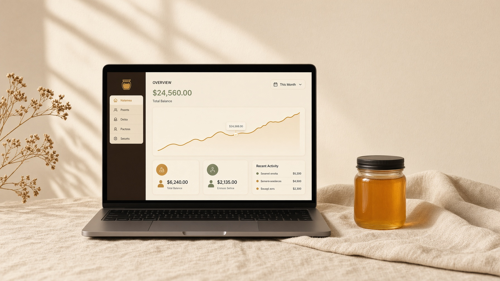
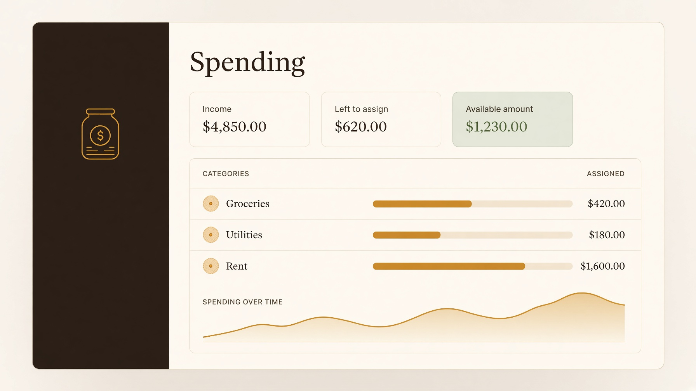
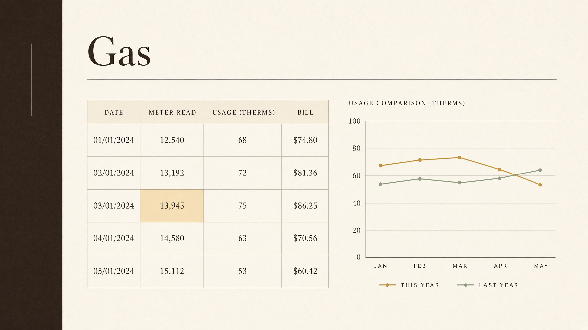

# HoneyJar

The household books, in one jar. Spending, bills, a utility workbook, a plan, cash a year out, net worth, a portfolio, and a tax worksheet. A business or a rental keeps its own jar. You type the numbers. HoneyJar does not log into a bank.



Apache License 2.0. A derived app keeps the attribution in [NOTICE](NOTICE) where its users can read it.

## Where it runs

HoneyJar is one app with two seats, not a server-only product.

| Seat | What you have today | When to use it |
| --- | --- | --- |
| On one machine | Leave `DATABASE_URL` unset. The books sit in a file at `data/pglite`. | Try it, or keep a private copy on the computer in front of you. |
| As a server | Set `DATABASE_URL` to Postgres 15 or newer. Docker Compose can start the app and the database together. | More than one person, or a machine that stays on. |

A packaged app you open like any other program, with no Node process to think about, is the direction. The screens and the books stay the same product either way. That package is not built yet. Today you start it with Node, or with Docker.


## What it can do

**Money.** This month’s spending and income. A register you can filter by account, category, person, and tag. Rules that file a merchant when you save. Bills and subscriptions by month, with a payment that can attach an existing transaction. A spending plan that rolls an envelope forward, and a projection from the same month in the last two years. Cash from liquid accounts, out to a year.



**Utilities.** A workbook for each meter, on the jar that owns it. You name the columns. Calculated cells fill in, including a cell that depends on another calculated cell. A blank number counts as zero. A meter can reset or roll over on the same bill. Child meters roll up to the parent for that month. Graphs compare a column with last year. CSV import maps your columns and will not invent a second read for a month you already have.



**Wealth and tax.** Net worth from accounts, homes, cars, and debts you typed. A portfolio of lots, prices you type, dividends, and sales. Goals, milestones, and a credit score you enter. Reports you can save. A federal estimate for tax year 2026, with lines for Schedules A through F. That screen is a planner. It is not a return, and it is not tax advice.

**Household.** People on a transaction or a bill. Contacts. Documents, with an optional vault that encrypts a note in the browser (AES-256-GCM) before it is stored. Share a household with a partner or an advisor. An advisor brief can go to Grok, OpenAI, or an Ollama server you name. It is told not to invent a number that is not in the brief.

**Jars.** The personal jar is home. A business jar is its own ledger, with invoices and mileage. A property jar keeps a lease and the rent. Summary adds the jars. It does not mix their categories.

The sample household is fiction, the Calders. The first sign-in asks you to name the household and starts blank. **Load sample household** in Customize puts the sample in, and it asks before it replaces what you already typed.

## Install

You need [Node 22](https://nodejs.org/) and npm. Docker is optional.

```bash
git clone https://github.com/davisjw/HoneyJar.git
cd HoneyJar
npm install
npm run dev
```

Open [http://127.0.0.1:8080](http://127.0.0.1:8080). Choose **Need an account**. The password has to be at least 8 characters. Leave `DATABASE_URL` unset for this first run. That is the local setup: one machine, books in `data/pglite`. Stopping the process does not delete the books. Deleting that directory does. The same steps, including Windows, are under [Local setup](docs/install.md#local-setup).

App and Postgres together:

```bash
docker compose up --build
```

Open [http://localhost:8080](http://localhost:8080). The Compose file binds the app to localhost. Leave `BETTER_AUTH_SECRET` unset and the app generates one on first start. The database password in that file is `honeyjar`.

Advisor is on the household menu after you sign in. Grok answers only when the server has `XAI_API_KEY`. OpenAI and a local Ollama are the other two. What gets sent, and how to turn each one on, is in [Install](docs/install.md#advisor).

The longer path is in [docs/install.md](docs/install.md): Postgres on its own, a reverse proxy, and a host that already has nginx. [docs/features.md](docs/features.md) is the screen-by-screen list. [docs/architecture.md](docs/architecture.md) is for someone changing the code. [docs/release.md](docs/release.md) is the list to read before the repo is public.

### Asking Grok to install it

[Grok Build](https://x.ai/cli) runs on your computer. In this repo, ask it to follow [docs/install.md](docs/install.md). It will use the same Node and npm commands. It does not install a different edition of HoneyJar.

Grok Bot is a different product. HoneyJar is not a bot plugin, and the bot does not host these books. If a bot has a shell on a machine, it can run the commands above. The app is still HoneyJar, on that machine or on a server you choose.

## What it will not do

- Log into a bank, a card, or a brokerage. Balances are what you last typed. A CSV import is the other way in.
- Quote a live stock price. Portfolio prices are typed.
- File a tax return.
- Encrypt the books. The vault covers document bodies saved after you set a passphrase. Transactions and bills are ordinary database rows.

## License

[Apache License 2.0](LICENSE). Report a vulnerability the way [SECURITY.md](SECURITY.md) describes. Do not put a household export in an issue. Changes go through [CONTRIBUTING.md](CONTRIBUTING.md). People working on the project follow [CODE_OF_CONDUCT.md](CODE_OF_CONDUCT.md).

`AGENTS.md`, `public/__grok/`, and `scripts/grok-*` are instructions from the builder that produced this app. They are not required to run HoneyJar.
