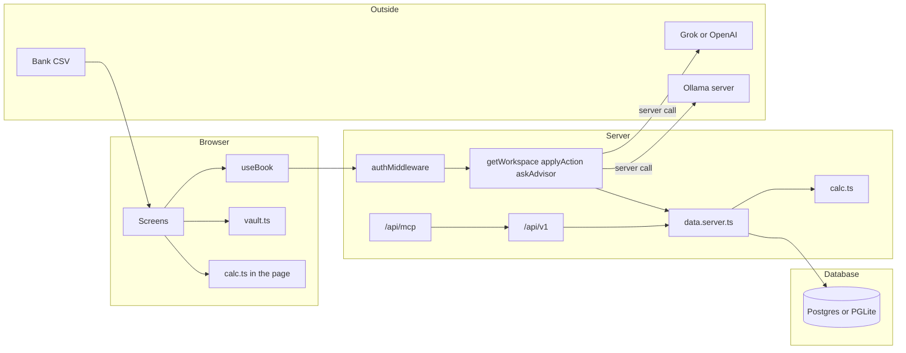
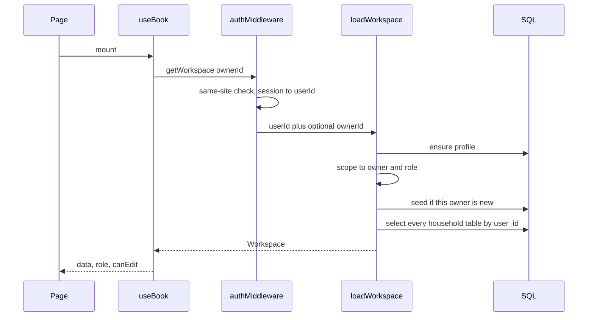
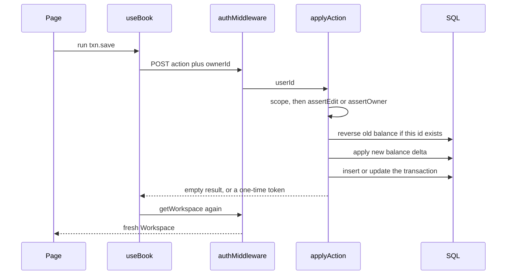
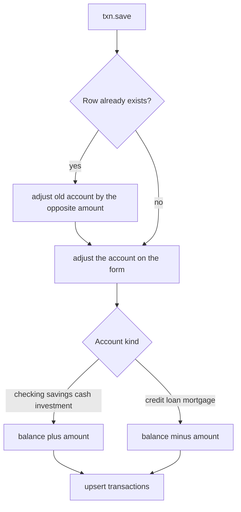
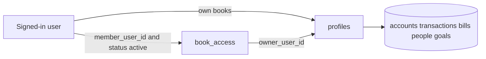
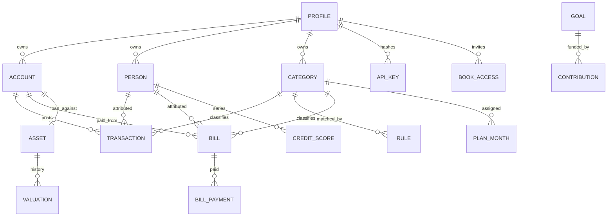
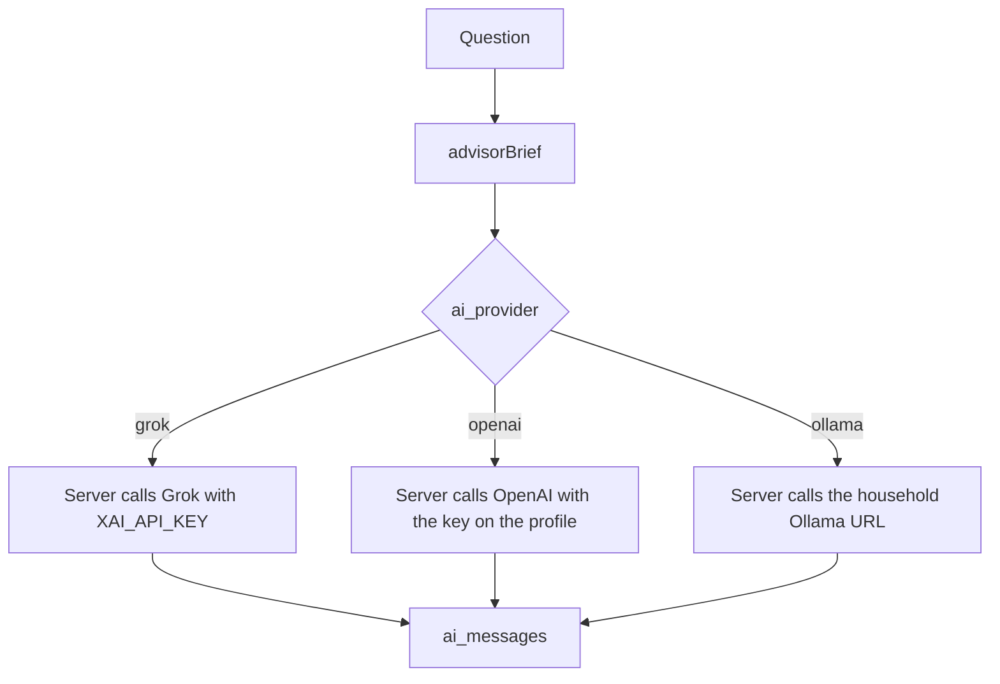
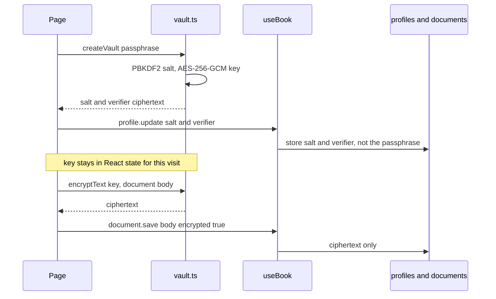
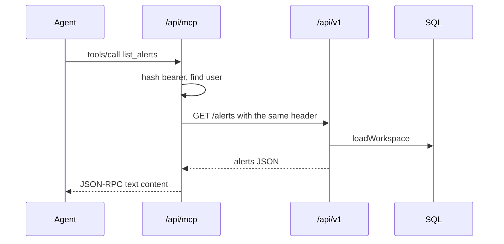

# Architecture

HoneyJar v2 is a TanStack Start app. The browser talks to server functions. Those functions read and write one SQL database. Almost every screen is a view over one `Workspace` object for the signed-in household.

```text
Browser (React 19, TanStack Router)
  useBook()  ->  getWorkspace / applyAction / askAdvisor
                         |
                    authMiddleware  (user id, then book_access)
                         |
                    data.server.ts  +  calc.ts
                         |
              Postgres, or PGLite when no DATABASE_URL
```

Money math lives in `src/lib/honey/calc.ts` so the UI, the API, and the advisor brief share one set of rules.

## Stack

| Piece | Choice |
| --- | --- |
| App | TanStack Start / Router / Query, React 19 |
| Style | Tailwind v4, honey / clay / sage tokens, Fraunces and Outfit |
| Charts | Recharts |
| Auth | Better Auth: email and password, Google, X |
| Database | `pg` when `DATABASE_URL` is set, otherwise `@electric-sql/pglite` |
| SQL | `getSql()` in `src/lib/db.ts`. Tagged queries. Bigints and dates normalized. |
| Deploy shape | Vite build, then copy PGLite assets, then migrate |

`@tanstack/react-start` must stay on 1.168.60 or newer.

## Routes

Signed-in screens sit under `src/routes/_app/`. The shell in `src/components/honey/shell.tsx` groups them:

| Group | Screens |
| --- | --- |
| Money | Spending, Transactions, Bills, Spending plan, Cash flow |
| Wealth | Net worth, Goals, Milestones, Credit |
| Tax and reports | Reports, Taxes, Watchlists, Reminders |
| Household | People, Documents, Sharing, Accounts, Advisor, Customize |

`nav_hidden` on the profile is a comma-separated list of nav ids. Customize writes it. The shell hides those links.

Server endpoints:

- `POST/GET /api/auth/$` — Better Auth.
- `GET/POST /api/v1/$` — household API. Bearer `hj_…`.
- `POST /api/mcp` — a small JSON-RPC tool list over the same API.

## Request path

`src/lib/honey/fns.ts` exposes three server functions, all behind `authMiddleware`:

- `getWorkspace` loads the books.
- `applyAction` applies one tagged action (`txn.save`, `bill.pay`, `person.save`, …). The full union is `Action` in `src/lib/honey/types.ts`.
- `askAdvisor` builds a brief and calls a model.

The client keeps one query cache of the workspace. A successful action invalidates it. Viewers can read. Mutations check the role. Owner-only actions (invites, API keys, clearing the sample) are refused for everyone else.

`loadWorkspace` scopes every select by `user_id`. A shared book passes the owner’s id after `book_access` says this member may see it. Roles are `owner`, `editor`, `viewer`, and `advisor`.

## How a click becomes rows

Three doors reach the same books. The screens use server functions. A script uses `/api/v1`. An agent uses `/api/mcp`, which is only a thin call onto `/api/v1`. None of them query SQL from the browser.



Grok, OpenAI, and Ollama sit outside the app. `askAdvisor` calls all three from the server. The browser does not call Ollama.

`calc.ts` is imported on both sides. The page uses it to draw a chart from the workspace it already has. The server uses it for alerts, the tax estimate, the plan, and the advisor brief. There is no second copy of the tax brackets.

### Read path

Opening any signed-in screen does not fetch that screen’s table. `BookProvider` loads the whole household once.



`ownerId` lives in `localStorage` under `honeyjar.owner`. Empty means “my own books.” A partner who accepted an invite sets it to the other household. The query key is `["workspace", ownerId]`, so switching books does not show the previous household’s cache.

`scope` is the only place a caller becomes allowed to see someone else’s rows:

- No foreign owner, or the owner is yourself: role `owner`.
- Otherwise one active `book_access` row must name you as `editor`, `viewer`, or `advisor`. Anything else throws.
- Seeds run only when you are the owner. Opening a shared book never writes the Calder sample into it.

The OpenAI key is stripped on the way out. The client sees `openaiKeySet`, not the key. API keys come back as id, name, and prefix.

### Write path

A screen never updates a balance by itself. It calls `run(action)`. That posts one `Action`, then throws away the cached workspace and loads it again. The next paint is whatever SQL just stored.



Role gate, in order:

| Action | Who |
| --- | --- |
| `invite.accept` | Any signed-in user. Checked before scope, because the code is the permission. |
| Profile, invites, API keys, load or clear sample | Owner only |
| Everything else | Owner or editor. Viewer and advisor get “view-only access.” |

`canEdit` on the client hides buttons for viewers. The server check is the one that counts.

Owner-only results that must not be cached: `apikey.create` returns the raw `hj_` token once. `invite.create` returns the code once. The following `getWorkspace` only has the prefix and the code list the owner already saved.

### What one transaction touches

Saving a transaction is the pattern the other money writes follow. Amounts are cents. Negative is money out. Positive is money in.



`adjust` refuses an account id that is not this household’s. Editing a transaction first undoes the old delta, then applies the new one, including a move between accounts. Deleting a transaction only undoes the delta and deletes the row.

CSV import and `POST /api/v1/transactions` call the same `txn.save` / import path, so a file and a script move balances the same way a typed row does. Import stamps `source = import`. The API stamps `source = api`.

Paying a bill writes a `bill_payments` row and a transaction, then moves the account. If the bill names a debt account, the principal portion reduces that debt too.

### Who the rows belong to

Every household table carries `user_id`, and that id is the owner’s user id, not the visitor’s. Sharing does not copy rows.



An invite starts as `pending` with a code and an email. Accept sets `member_user_id` and `status = active`. Revoke drops the grant. The visitor’s own profile stays their profile. Switching households only changes which owner id the next load uses.

### How the tables connect



Reports, watches, reminders, documents, milestones, snapshots, and advisor messages hang off the profile only. A document may also store `related_type` and `related_id` (an asset, an account, a tax year) as text. That link is not a foreign key.

Tags are not a table. They are a JSON array on the transaction. A report grouped by tag walks that array and can count one purchase under two tags.

### Charts, tax, and alerts

Those screens do not have their own queries. They take the workspace and call `calc.ts`:

| Question | Function | Inputs |
| --- | --- | --- |
| Spending pie | `spendingByCategory` | transactions, categories, month window, optional person and tag |
| By person | `personFlow` | the same window |
| Plan leftover | `planModel` | categories, transactions, `plan_months`, month |
| Year of cash | `projectCash` | liquid balances, bills, recent spending |
| Net worth | `netWorthParts` | full asset values plus cash and investments, minus debt balances. A linked loan is counted once, in debts. `assetEquity` is only the per-asset card |
| Tax worksheet | `taxLines`, `estimateTax` | categories’ schedule and line, profile wages and withholding, 2026 brackets |
| Watchlist | `evaluateAlerts` | watches, bills, goals, scores, plan rows, reminders |

A filter on the dashboard narrows the pie and the by-person bars. The headline cards for the month stay on the unfiltered set.

### Advisor

The model never receives the workspace. `askAdvisor` builds a few lines with `advisorBrief`: household name, net worth, account balances, this month’s top categories, the next bills, goals, filing status. History is the last eight `ai_messages`.



The server calls every provider. For Ollama, `askAdvisor` posts the brief and the question to the household’s Ollama URL. The browser does not call Ollama. If that host is unreachable, the error says the server makes the call, not the browser. The question and the answer are written to `ai_messages` on the server before the answer returns, for Ollama as well as for Grok and OpenAI. `advisor.log` can still insert a pair of messages, but the Advisor screen does not use it.

### Vault

Encryption is not a column transform inside SQL. The browser encrypts, then the ciphertext is just another string in `documents.body`.



Unlock derives the key again and decrypts the verifier. If the plaintext is not the marker `honeyjar-vault-ok`, the passphrase is wrong and no key is kept. Locking clears React state. A reload locks the vault. Documents saved before a vault exists are stored as plaintext with `encrypted = false`.

### API and MCP

`/api/v1` does not use the session cookie. It hashes the bearer token and looks up `api_keys.token_hash`. The matched user id is the owner. A partner’s key reads the partner’s own books, not a book that was shared with them in the UI.



MCP tools are the GET routes, including people, document names, utilities, and jars. `list_transactions` and `list_jars` accept a date range. The only write on this door is `POST /transactions`. A key may expire, and each process allows 60 requests a minute.

## Data

Migrations:

| File | What it adds |
| --- | --- |
| `migrations/0001_auth.sql` | Better Auth `user`, `session`, `account`, `verification` |
| `migrations/0002_honey.sql` | Profile, sharing, accounts, categories, rules, transactions, bills, assets, goals, plan, watches, reminders, documents, scores, milestones, reports, API keys, advisor messages |
| `migrations/0003_people.sql` | `people`, plus `person_id` on transactions, bills, and credit scores |
| `migrations/0004_tags.sql` | `transactions.tags` text, default `[]` |

Conventions:

- Primary keys are text ids, up to 80 characters.
- Money is `bigint` cents. A negative transaction is an outflow. A positive transaction is an inflow. Account balances are stored as positive magnitudes. Debt kinds (`credit`, `loan`, `mortgage`) subtract from net worth.
- Dates are `YYYY-MM-DD`.
- Tags are a JSON array in a text column, parsed by `parseTags`.
- Category rules are substring matches, then a built-in merchant dictionary (groceries, utilities, payroll, and so on).
- A month can start on a day other than the 1st (`month_start_day`). Plan, spending, and cash flow all use that.

The Calder sample is `seedHousehold` in `src/lib/honey/seed.ts`. It is idempotent per user. People and tags on older sample rows are backfilled by `ensureSamplePeople` and `ensureSampleTags`.

### Accounts and the bank

There is no Plaid connection and no stored bank password. An account row has a name, an institution, a kind, a mask, and a balance the household typed. `connected` means “we treat this as linked for display,” not “we have a feed.” CSV import parses a loose date / amount / description file and inserts transactions with `source = import`. The public API can also post a transaction with `source = api`.

### Net worth and Zillow

Assets (home, vehicle, other) have a value, an as-of date, and an optional linked loan account so equity is value minus that balance. Valuation history is its own table. The Zillow field is a URL the household can open. Any Zestimate is a number they saved.

### Plan

Each category has a monthly assignment and a rollover flag. `planModel` compares assigned cents with activity for the month and carries leftovers when rollover is on.

### Cash flow

`projectCash` walks from liquid balances forward: bills on their cadence, and the shape of recent spending, out to the horizon the screen asks for (up to a year).

### Tax

`estimateTax` and `taxLines` in `calc.ts`. Federal brackets and the standard deduction are the 2026 figures. Categories can carry a schedule and a line (A through F). The screen is a year-to-date worksheet plus a quarterly planner (withholding, estimates, prior-year safe harbor). It does not file anything.

### People, tags, reports

A person has a name and a relation (`adult`, `child`, …). Transactions and bills store `person_id`. Credit scores do too, so each person has their own series. Reports take a metric, a range, a group (`category`, `person`, or `tag`), and `filters_json`. A transaction with two tags can count in both tag groups. Dashboard charts use the same filters but the headline month totals stay unfiltered.

### Documents and the vault

A document row is a title, a kind, a year, a link to another record (`related_type`, `related_id`), notes, and an optional body. The vault is not the document table.

`src/lib/honey/vault.ts` runs in the browser:

- PBKDF2-SHA256, 120,000 iterations, random salt.
- AES-GCM with a 256-bit key.
- The server stores only `vault_salt` and `vault_verifier` (the ciphertext of a fixed marker). A wrong passphrase fails the marker check.
- The passphrase and the raw key are not written to the database.

### Sharing and API keys

`book_access` holds an invite code, an email, a role, and a status. Accepting an invite attaches `member_user_id`.

API keys are created in Customize. The raw token is shown once, prefixed `hj_`. The database stores a SHA-256 hash and a short prefix. `/api/v1` and `/api/mcp` both require `Authorization: Bearer`.

Public reads: `/summary`, `/accounts`, `/transactions`, `/bills`, `/goals`, `/networth`, `/portfolio`, `/alerts`, `/people`, `/documents` (names only), `/utilities`, and `/jars`. Public writes: `POST /transactions`. A key can carry an expiry. Each server process allows 60 requests a minute.

MCP methods are `initialize`, `tools/list`, and `tools/call`. The tools are the same reads: spending summary, accounts, transactions, bills, net worth, goals, alerts.

### Advisor

`advisorBrief` reduces the household to a few lines: net worth, account balances, this month’s spending, upcoming bills, goals, filing status. The system prompt tells the model not to invent numbers and not to act as a broker or a preparer.

- **Grok** uses `XAI_API_KEY` on the server and `grok-4.5`.
- **OpenAI** uses the key stored on the profile. The profile sent to the client only has `openaiKeySet`, not the key.
- **Ollama** is called from the server. `askAdvisor` posts the brief and the question to the household’s Ollama URL. The browser does not call Ollama. The address has to be one the HoneyJar server can open. `127.0.0.1` works only when Ollama is on that same machine.

The last few turns are stored in `ai_messages`.

## UI map

| Path | Module |
| --- | --- |
| `src/components/honey/book.tsx` | Workspace query and `run(action)` |
| `src/components/honey/shell.tsx` | Nav, month label, sign-in |
| `src/components/honey/welcome.tsx` | First-run gate |
| `src/components/honey/screens/dashboard.tsx` | Spending |
| `src/components/honey/screens/money.tsx` | Transactions, bills, plan, cash flow |
| `src/components/honey/screens/wealth.tsx` | Net worth, goals, milestones |
| `src/components/honey/screens/people.tsx` | People |
| `src/components/honey/screens/desk.tsx` | Reports, taxes, watches, reminders, documents, credit, accounts, advisor, settings, sharing |

Transaction and bill editors are mounted only while open and keyed by id, so a new row does not reuse another row’s state.

## What this shape is not ready for

A live bank feed, a live quote, and a filed tax return are still out. Investments, business jars, invoices, mileage, and property leases are in. The open jar loads two years of transactions; older rows load on request. A save patches that row instead of reloading every jar.
